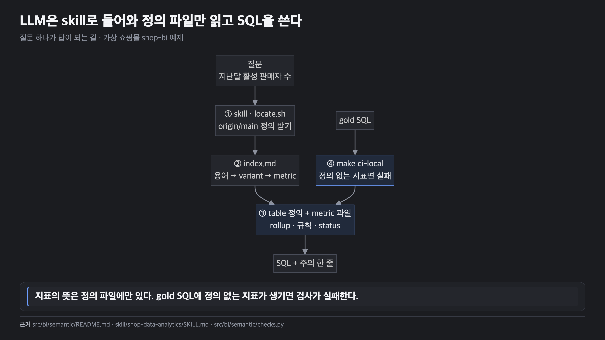

# semantic-layer-pattern

LLM agent가 정의 파일만 읽고 지표를 맞게 골라 SQL을 쓰게 하는 semantic layer 설계다. 회사 업무에서 설계하고 만든 것을 가상 쇼핑몰 도메인(`shop-bi`)으로 다시 썼다. 지표 정의와 gold SQL은 모두 지어낸 예제이고, 형식·검사·skill은 실제로 돌아간다.



## 푼 문제

gold table과 대시보드는 돌아가는데 지표의 뜻이 SQL 안과 wiki 여러 곳에 흩어져 있었다. "활성 회원"처럼 같은 이름이 서너 가지 뜻으로 쓰였고, 사람이든 LLM이든 새 질문마다 table·column·공통 filter를 다시 찾다가 틀렸다.

## 설계의 핵심

1. **정본은 업계 표준 형식이다.** dbt MetricFlow semantic manifest YAML을 그대로 쓰고, 표준에 없는 뜻은 `config.meta.shop`에, 어느 표준에도 자리가 없는 것은 옆 파일에 둔다. → [docs/design.md](docs/design.md)
2. **파일 하나에 정의 하나다.** table 정의 파일과 metric 파일을 나누고, 생성물 `index.md`를 진입점으로 삼는다. LLM은 지표 하나에 답할 때 파일 둘만 읽고, 사람이 지표 하나를 더하면 diff가 그 파일에만 생긴다.
3. **모호함을 지우지 않고 적는다.** 뜻이 여럿인 용어는 term → variant → metric으로 나눠 모두 두고, metric마다 status(`confirmed` · `code_only` · `conflict` · `query_time`)와 원본 등급(A~D)을 붙이고, 정본을 정할 owner에게 물을 질문을 목록으로 남긴다.
4. **합산 규칙을 정의에 적는다.** measure마다 rollup `sum` · `last` · `none`을 적어, 이미 중복을 뺀 값을 날짜를 넘어 더하는 실수를 막는다.
5. **정의 없는 지표는 검사가 막는다.** gold SQL에서 지표 code를 뽑아 정의와 견주고, 빠진 것이 있으면 만들 파일 경로와 붙여 넣을 최소 문서를 보여 주며 실패한다. 읽지 못한 SQL 갈래도 실패다. → [docs/verification.md](docs/verification.md)
6. **검사를 검사한다.** 정의를 하나씩 망가뜨린 사본에서 검사가 그 문제를 잡는지 test로 본다.
7. **LLM은 얇은 skill로 들어온다.** skill에는 지표의 뜻이 한 줄도 없다. skill은 정의 폴더를 최신 main으로 찾아 그곳 README를 따르게 할 뿐이고, 읽는 법은 YAML 형식과 같은 변경에서 고친다. → [docs/llm-entry.md](docs/llm-entry.md)
8. **정답률은 질문 eval로 본다.** 새 agent가 질문에 SQL과 기준 block으로 답하고, 정답 SQL과 결과를 견준다.

결정마다 이유와 버린 후보는 [docs/decisions.md](docs/decisions.md)에 있다.

## 폴더

| 경로 | 담는 것 |
|---|---|
| `docs/` | 설계([design](docs/design.md)), 결정과 이유([decisions](docs/decisions.md)), LLM이 들어오는 길([llm-entry](docs/llm-entry.md)), 검사와 검증([verification](docs/verification.md)) |
| `src/bi/semantic/` | 정의 폴더. README(읽는 법·쓰는 법), `index.md`(생성물), `manifest/`(table 5개, 관계 2개, metric 32개), `glossary/`, `questions/`, 옆 파일 넷, 그리고 `catalog.py` · `checks.py` · `render.py` |
| `src/aggregation/`, `src/warehouse/` | 가상 gold·silver SQL. 정의가 가리키는 대상이고 검사가 읽는다 |
| `src/bi/shop_rules.py` | 내부·테스트 판매자를 빼는 SQL 조각의 정본 |
| `tests/bi/semantic/` | 실제 정의 검사, 정의를 망가뜨려 보는 test, eval 질문 10개 |
| `scripts/semantic_eval.py` | 질문 eval(`pack`, `score`) |
| `skill/shop-data-analytics/` | 얇은 skill: `SKILL.md`, `VERSION`, `scripts/locate.sh`와 그 test |

원래 설계는 정의 저장소와 skill 저장소가 서로 다른 repo다. 여기서는 한 repo에 담았다.

## 돌려 보기

Python 3.10 이상이 필요하다.

```bash
python3.12 -m venv .venv && ./.venv/bin/pip install -r requirements.txt
```

```bash
make test
```

`make test`는 정의 검사와 망가뜨려 보는 test 66개를 돌린다. skill의 `locate.sh` test 37개는 따로 돌린다.

```bash
PYTHONDONTWRITEBYTECODE=1 ./.venv/bin/python -m pytest -q -p no:cacheprovider skill/shop-data-analytics/scripts/test_locate.py
```

검사가 일하는 모습을 보려면 `src/bi/semantic/manifest/metrics/commerce/shop_kpi_daily/wau.yml`을 다른 곳으로 옮기고 `make test`를 돌린다. "gold에 있는 지표 'wau'가 정의에 없다"와 함께 만들 파일 경로, 붙여 넣을 metric 문서가 나온다.

정의를 고친 뒤에는 생성물을 다시 만든다.

```bash
./.venv/bin/python -m src.bi.semantic.render
```

## 자기 project에 옮기기

1. `src/bi/semantic/`의 `catalog.py` · `checks.py` · `render.py`와 `tests/bi/semantic/`을 가져간다.
2. 이름을 바꾼다: namespace `meta.shop`, `catalog.py`의 `CATALOG`, `shop_rules.py`의 내부 계정 제외 조각, `rules.yml`의 규칙.
3. `catalog.py`는 Databricks SQL 모양(`CREATE TABLE`, `INSERT INTO ... REPLACE WHERE`, `CREATE OR REPLACE VIEW`)을 regex로 읽는다. gold SQL을 쓰는 방식이 다르면 여기를 고친다. 쓰는 쪽은 `tables()` · `long_codes()` · `seed_codes()` · `view_columns()`만 안다.
4. 정의를 쓴다. 정의 폴더 README의 "정의 쓰기"가 차례를 알려 주고, 검사 실패 메시지가 빠진 파일을 알려 준다.
5. skill은 `locate.sh` 첫머리의 `DEFS_REPO` · `SKILLS_REPO` 두 줄과 `SKILL.md`의 description을 바꾼다.

## 알아 둘 것

- 가상 예제에는 warehouse가 없다. gold SQL은 실행해 보지 않았고, 질문 eval의 `score`도 이 repo에서는 돌려 보지 않았다. `score`는 Databricks SQL warehouse를 쓴다.
- 실제 적용에서는 table 18개, metric 약 300개 규모였다. 이 예제는 설계의 갈래(long·wide table, family, seed가 정하는 code, 물려받는 code, 스냅샷, ratio, query_time)가 하나씩 보이도록 줄였다.
- 검사는 hook이 아니다. 정의나 gold SQL을 고친 사람이 `make ci-local`을 직접 돌린다.
