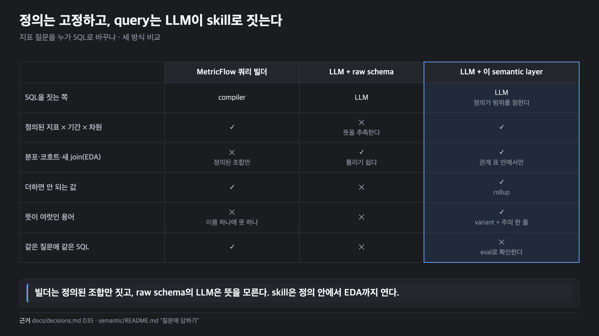
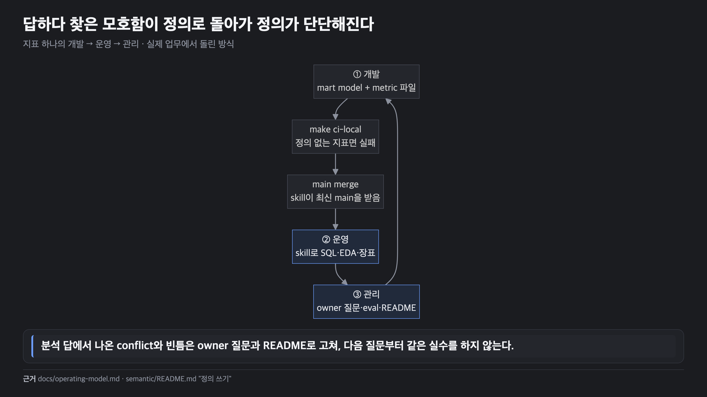

# semantic-layer-pattern

LLM이 SQL을 짓고 EDA까지 할 수 있게 여는 semantic layer와 그 운영 방식이다. dbt project의 mart layer 위에 얹는다.

업무에서 semantic layer를 만들고, data analytics skill로 운영하고, 정의를 관리하던 구조를 다른 dbt project에 옮겨 쓸 수 있게 템플릿으로 정리했다. 정의와 data는 가상 쇼핑몰 dbt project(`shop-bi`)의 참조 구현이고, DuckDB에서 처음부터 끝까지 돈다. MIT license다.



## 무엇이 다른가

semantic layer의 보통 쓰임은 쿼리 빌더다. MetricFlow 같은 도구는 정의된 metric × 기간 × dimension 조합을 받아 SQL을 결정적으로 짓는다. 늘 같은 답을 내지만, 분포·코호트·새 join처럼 정의된 조합 밖의 질문이나 앞 답을 보고 이어 묻는 EDA는 못 한다.

이 방식은 SQL을 LLM이 skill로 짓게 연다. 다만 raw schema가 아니라 정의를 읽고 짓는다. 정의가 정하는 것은 이렇다.

- 어느 column·code가 그 지표인가
- 기간으로 더해도 되나(rollup)
- 꼭 걸어야 하는 filter
- 이을 수 있는 table
- 뜻이 여럿인 말을 무엇으로 읽나
- 이 지표를 얼마나 믿나(status와 원본 등급)

정의에 없는 지표는 짓지 않는다. 결정성을 내주는 대가로 정답률은 질문 eval로 따로 본다. MetricFlow는 형식 검사기로 그대로 쓴다. → [docs/operating-model.md](docs/operating-model.md#왜-쿼리-빌더가-아니라-skill인가)

## 개발·운영·관리



| 단계 | 누가 | 무엇을 | 무엇이 지키나 |
|---|---|---|---|
| 개발 | 지표를 만드는 사람 | mart model과 같은 PR에서 metric 파일을 쓴다 | `make ci-local`. 정의 없는 지표는 무조건 실패하고, 붙여 넣을 문서를 보여 준다 |
| 운영 | 분석하는 사람 누구나 | skill에 묻고, SQL·표·장표를 보고, 다음 분석을 고른다 | skill이 늘 최신 main의 정의를 받는다. 답에는 확정되지 않은 정의가 주의 한 줄로 붙는다 |
| 관리 | 지표 owner·관리자 | 열린 질문에 답하고, 원본 등급을 고치고, eval을 돌린다 | owner 확인 목록, 원본 등급 A~D, eval 기록 |

세 단계를 어떻게 돌리는지와 운영하며 정한 규칙은 [docs/operating-model.md](docs/operating-model.md)에 있다.

## 설계의 핵심

1. **정본은 업계 표준 형식이다.** MetricFlow semantic manifest YAML을 그대로 쓴다. 표준에 없는 뜻은 `config.meta.<namespace>`에, 어느 표준에도 자리가 없는 것은 옆 파일에 둔다. → [docs/design.md](docs/design.md)
2. **파일 하나에 정의 하나다.** LLM은 지표 하나에 답할 때 파일 둘만 읽고, 사람이 지표 하나를 더하면 diff가 그 파일에만 생긴다.
3. **모호함을 지우지 않고 적는다.** 뜻이 여럿인 용어는 term → variant → metric으로 나눠 모두 두고, metric마다 status와 원본 등급을 붙이고, owner에게 물을 질문을 남긴다.
4. **정의 없는 지표는 검사가 막는다.** mart model의 SQL에서 지표 code를 뽑아 정의와 견주고, 읽지 못한 SQL 갈래도 실패로 친다. 검사가 일하는지는 정의를 망가뜨린 사본으로 test한다. → [docs/verification.md](docs/verification.md)
5. **skill은 얇다.** skill에는 지표의 뜻이 한 줄도 없다. 정의 폴더를 최신 main으로 찾아 그곳 README를 따르게 할 뿐이라, 읽는 법은 정의 형식과 같은 PR에서 고친다. → [docs/llm-entry.md](docs/llm-entry.md)

결정마다 이유와 버린 후보는 [docs/decisions.md](docs/decisions.md)에 있다.

## dbt와의 관계

- pipeline은 dbt가 맡는다: `models/staging` → `models/intermediate` → `models/marts`. semantic layer는 mart만 덮는다.
- 정의 폴더 `semantic/`은 dbt가 읽는 폴더(model-paths) 밖에 있다. dbt project YAML(`semantic_models:`)이 아니라 standalone manifest라서, 파일 하나에 정의 하나를 두고 dbt profile 없이 오프라인 test로 검사한다.
- 정의와 mart를 잇는 것은 `node_relation`(schema.alias)과 `defined_in`(model 파일 경로)이다. 검사가 둘이 맞는지 본다.
- mart model의 column은 dbt contract로 선언한다. dbt가 build 때 SQL과 맞는지 강제하고, 검사는 그 yml을 읽는다.
- 지표 code를 정하는 규칙은 dbt seed이고, 공통 filter 조각의 정본은 dbt macro다. 정의의 SQL 조각은 그 macro를 render한 것과 같아야 한다.

## 폴더

| 경로 | 담는 것 |
|---|---|
| `semantic/` | 정의 폴더. README(읽는 법·쓰는 법), `index.md`(생성물), `manifest/`, `glossary/`, `questions/`, 옆 파일 넷, 그리고 `settings.py` · `catalog.py` · `checks.py` · `render.py` |
| `skill/shop-data-analytics/` | data analytics skill. 지표 고르기 → SQL → EDA를 대화로 잇기 → 차트·장표. `SKILL.md`, `VERSION`, `scripts/locate.sh`와 그 test |
| `models/`, `seeds/`, `macros/` | 참조 구현 dbt project. 정의가 가리키는 mart와 그 아래 layer, 가상 raw data |
| `tests/semantic/` | 실제 정의 검사, 정의를 망가뜨려 보는 test, eval 질문 10개 |
| `scripts/` | 질문 eval(`semantic_eval.py`), 가상 raw data 만들기(`gen_raw_seeds.py`) |
| `docs/` | 개발·운영·관리([operating-model](docs/operating-model.md)), 설계([design](docs/design.md)), 결정과 이유([decisions](docs/decisions.md)), LLM이 들어오는 길([llm-entry](docs/llm-entry.md)), 검사와 검증([verification](docs/verification.md)), eval 기록(`eval-runs/`) |

참조 구현은 table 정의 5개, 관계 2개, metric 32개, 용어 2개로 줄였다. 대신 설계의 갈래(long·wide table, family, seed가 정하는 code, 물려받는 code, 스냅샷, ratio, query_time)가 하나씩 다 들어 있다. 원래는 정의 저장소와 skill 저장소가 서로 다른 repo였고, 여기서는 한 repo에 담았다.

## 돌려 보기

Python 3.10 이상이 필요하다.

```bash
python3.12 -m venv .venv && ./.venv/bin/pip install -r requirements.txt
```

정의 검사와 망가뜨려 보는 test 68개를 돌린다. dbt도 warehouse도 필요 없다(DuckDB 파일이 있으면 catalog가 읽은 column이 실제 mart와 같은지도 본다).

```bash
make test
```

참조 구현의 mart를 DuckDB 파일(`shop_bi.duckdb`)에 만든다.

```bash
make build
```

skill의 `locate.sh` test 37개는 따로 돌린다.

```bash
PYTHONDONTWRITEBYTECODE=1 ./.venv/bin/python -m pytest -q -p no:cacheprovider skill/shop-data-analytics/scripts/test_locate.py
```

검사가 일하는 모습을 보려면 `semantic/manifest/metrics/commerce/shop_kpi_daily/wau.yml`을 다른 곳으로 옮기고 `make test`를 돌린다. "mart에 있는 지표 'wau'가 정의에 없다"와 함께 만들 파일 경로, 붙여 넣을 metric 문서가 나온다.

## skill 써 보기

skill을 symlink로 걸면 Claude Code에서 "지난달 활성 판매자 수", "MAU 추이 차트로" 같은 질문에 켜진다.

```bash
ln -s "$(pwd)/skill/shop-data-analytics" ~/.claude/skills/shop-data-analytics
```

skill은 돌 때마다 이 repo의 main에서 `semantic/`을 받아 그곳 README대로 지표를 고르고 SQL을 쓴다. 답마다 다음 분석 선택지를 붙여 EDA를 대화로 이어 간다. SQL은 `make build`가 만든 `shop_bi.duckdb`에서 돌린다.

## 자기 dbt project에 옮기기

1. "Use this template"로 복제하거나 `semantic/`(Python 넷과 README), `tests/semantic/`, `skill/`을 가져간다. 예제 정의(`manifest/`, `glossary/`, `questions/`, 옆 파일의 내용)는 비운다.
2. `semantic/settings.py`를 고친다: namespace(`config.meta.<이름>`), project 이름, layer 폴더와 schema의 대응, semantic layer가 덮을 schema.
3. mart model에 column을 선언한다(model yml의 `columns`, 되도록 contract). long table의 지표 code는 literal · `CASE` · 앞 literal 이어 붙이기로 쓴다. `catalog.py`는 dbt model의 SELECT를 regex로 읽는다. SQL을 쓰는 방식이 많이 다르면 여기를 고친다. 쓰는 쪽은 `tables()` · `long_codes()` · `seed_codes()` · `view_columns()` · `macro_sql()`만 안다.
4. `rules.yml`에 공통 규칙을 적는다. SQL 조각을 macro와 견주는 검사(`checks._side_files`)는 자기 macro 이름에 맞춘다.
5. 정의를 쓴다. 정의 폴더 README의 "정의 쓰기"가 차례를 알려 주고, `make test`의 실패 메시지가 빠진 파일과 붙여 넣을 문서를 알려 준다. 뜻이 갈리는 지표부터 glossary와 owner 질문으로 적는다.
6. skill은 `locate.sh` 첫머리의 `DEFS_REPO` · `SKILLS_REPO` 두 줄과 `SKILL.md`의 이름·description을 바꾼다.
7. test의 문자열(예제 metric 이름, SQL 조각)은 자기 정의에 맞게 바꾼다. 무엇을 망가뜨려 보는지는 그대로 쓴다.

## 알아 둘 것

- 참조 구현은 DuckDB(dbt-duckdb)에서 돈다. 다른 warehouse에서는 model의 날짜 함수와 `scripts/semantic_eval.py`의 `_connect` · `_run_sql`을 바꾼다.
- 검사는 hook이 아니다. 정의나 mart model을 고친 사람이 `make ci-local`을 직접 돌린다.
- skill frontmatter의 `model`은 사람이 `/`로 부를 때만 적용된다. 질문만으로 켜지면 세션 모델로 돈다(실측, [docs/llm-entry.md](docs/llm-entry.md#skill을-돌리는-모델)).

## License

[MIT](LICENSE)
