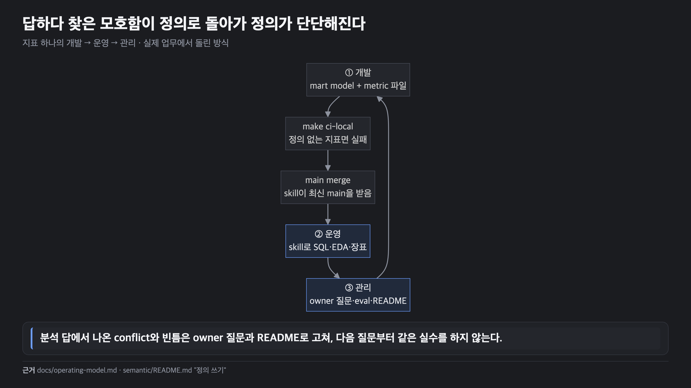
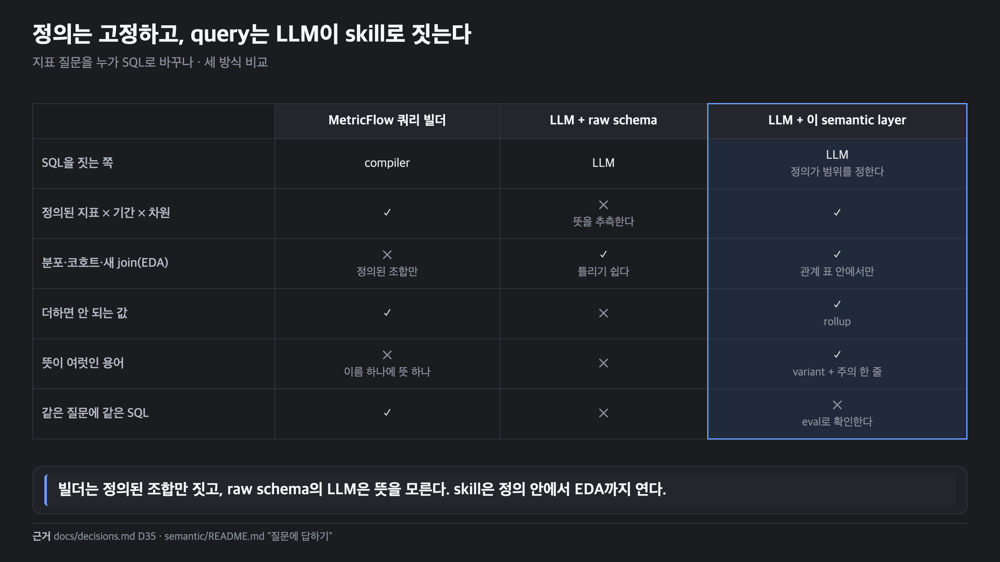

# 개발·운영·관리

이 repo는 실제 업무에서 semantic layer를 만들고, data analytics skill로 운영하고, 정의를 관리한 방식을 템플릿으로 남긴 것이다. 원래 정의와 data는 회사 것이라 옮기지 않았고, 같은 구조를 가상 쇼핑몰 dbt project(`shop-bi`)에 다시 세웠다. 이 문서는 그 방식을 사람과 일의 흐름으로 적는다. 형식은 [design.md](design.md), 결정과 이유는 [decisions.md](decisions.md), LLM이 들어오는 길은 [llm-entry.md](llm-entry.md), 검사는 [verification.md](verification.md)에 있다.

## 왜 쿼리 빌더가 아니라 skill인가

semantic layer의 보통 쓰임은 쿼리 빌더다. MetricFlow는 정의된 metric × 기간 × dimension 조합을 받아 SQL을 결정적으로 짓는다. 같은 질문에 늘 같은 SQL이 나오는 것이 장점이지만, 정의된 조합 밖은 못 간다. 실제로 받는 질문은 그 밖에 많았다.

- "Tier별 판매자 점수 분포는?", "가입월 코호트로 보면?", "이 판매자들의 단골 회원은 검색을 얼마나 하나?" 같은 분포·코호트·새 join
- 앞 답을 보고 이어 묻는 EDA: 범위 확인 → 추이 → 쪼개기 → 이상치

그래서 이 설계는 쿼리 빌더를 쓰지 않고 SQL을 LLM이 짓게 했다(D35). 다만 raw schema만 주고 짓게 하면 LLM은 지표의 뜻을 모른다. 이미 중복을 뺀 값을 더하고, 내부 계정을 빼는 것을 잊고, "활성"을 아무 뜻으로나 고른다. 정의가 그 자리를 막는다.

| LLM이 SQL을 지을 때 정의가 정하는 것 | 정의의 어디에 있나 |
|---|---|
| 어느 table의 어느 column·code가 그 지표인가 | table 정의의 `node_relation`, metric의 measure·filter |
| 기간으로 더해도 되나 | measure의 `rollup`(sum · last · none) |
| 질의하는 쪽이 걸어야 하는 filter | table의 `rules`와 `rules.yml`의 SQL 조각 |
| 이을 수 있는 table과 key | 관계 표(`manifest/tables/relations/`). 표에 없는 join은 하지 않는다 |
| 뜻이 여럿인 말을 무엇으로 읽나 | glossary의 default variant. 답에는 다른 뜻이 있다고 밝힌다 |
| 이 지표를 얼마나 믿나 | metric의 `status`와 원본 등급. 확정되지 않았으면 답 끝 주의 한 줄 |
| 없는 지표 | 정의에 없으면 SQL을 짓지 않고 없다고 답한다 |

정리하면 쿼리 빌더는 "정의된 것만, 늘 같게"이고, 이 방식은 "정의 안에서, 질문이 원하는 만큼"이다. 대가는 결정성이다. 같은 질문에 SQL이 매번 같다는 보장이 없어서, 질문 eval로 정답률을 따로 본다([verification.md](verification.md#질문-eval)). MetricFlow는 버리지 않았다. parser와 validator를 test에서 형식 검사기로 쓴다(D31).

## 세 역할

| 역할 | 하는 일 | 쓰는 것 |
|---|---|---|
| 지표를 만드는 사람(analytics engineer) | mart model을 고치거나 더하고, 같은 PR에서 정의를 쓴다 | `models/marts/`, `semantic/` README "정의 쓰기", `make ci-local` |
| 분석하는 사람(누구나) | 질문하고, skill이 낸 SQL·표·장표를 보고, 다음 분석을 고른다 | `shop-data-analytics` skill |
| 정의를 관리하는 사람(지표 owner, 관리자) | 열린 question에 답하고, 원본 등급을 고치고, eval을 돌린다 | `questions/`, `sources.yml`, `scripts/semantic_eval.py` |

분석하는 사람은 정의 파일을 몰라도 된다. skill이 정의를 읽고, 답 글에는 metric 이름이나 YAML 대신 지표의 뜻과 주의 한 줄만 보인다(D80).

## 개발: 지표 하나를 더한다

1. mart model에 지표를 더한다. long table이면 code를 literal · `CASE` · 앞 literal 이어 붙이기로 쓴다.
2. `make ci-local`을 돌린다. 정의가 없으면 검사가 실패하고, 만들 파일 경로와 붙여 넣을 최소 metric 문서를 보여 준다. 우회 표기는 없다(D15).
3. 그 파일을 만들고 자리표시를 채운다. kind와 rollup은 SQL을 보고 정한다.
4. status를 정한다. 근거는 코드 → model yml → 대시보드 SQL → 저장소 docs → wiki → 메신저 → job 설정 차례로 찾는다(D71). 문서와 코드가 다르면 `conflict`로 두고 owner 질문을 연다. 개발자가 정본을 고르지 않는다(D5).
5. `python -m semantic.render`로 `index.md`를 다시 만들고, 다시 검사해 PR을 낸다.

새 mart model이면 model yml에 column contract를 쓰고, table 정의 파일을 두거나 `not_modeled.yml`에 정의하지 않는 이유를 적는다.

## 운영: skill로 분석한다

skill은 돌 때마다 정의 저장소의 최신 main을 받는다. 작업 중인 branch의 낡은 정의로 답하지 않는다(D38). 확인이 안 되면 가진 것 중 가장 최근 정의로 답하고 그 사실을 주의 줄에 적는다(D39).

한 번의 답은 이런 모양이다(가상).

> **2026년 10월 활성 판매자는 9곳이다.**
> 조건: 2026-10, 사용 기준(주문·검색 기록이 있는 판매자), 내부 판매자 제외
>
> | 출처 | 판매자 수 |
> |---|---|
> | 주문 | 9 |
> | 검색 | 9 |
>
> 발견: 고객문의만 있고 주문이 없는 판매자는 없다 `확인`
>
> 주의: "활성 판매자"는 유료 플랜 기준으로도 센다(공식 정의는 확인 중). 질의할 때 계산한 값이다.
>
> 다음 분석
> 1. (추천) [쪼개기] 활성 판매자 9곳의 월 주문 수 분포 — 상위 몇 곳에 몰렸는지
> 2. [견주기] 같은 달 유효 유료 플랜 수와 견주기 — 두 기준이 몇 곳 다른지
> 3. [정리] 여기까지를 요약과 장표로 묶는다

- 사용자가 번호로 고르면 그 질문 그대로 이어 간다. 한 turn에 질문 하나, 다음은 사용자가 고른다.
- 발견마다 `확인`(query로 봤다), `정의`(정의에 적혀 있다), `추정`(둘 다 아니다)을 붙인다.
- 장표는 사용자가 원하거나 표로 읽히지 않을 때만 만든다.

## 관리: 정의를 단단하게 한다

- **owner 질문**: `conflict`와 `query_time` metric은 question이 꼭 있다. `index.md` 끝에 owner 확인 목록으로 모인다. 답을 받으면 `state: answered`와 답을 적고, 정의를 고치고, status를 바꾼다.
- **원본 등급**: wiki 문서마다 A~D 등급과 확인한 날을 적는다. 문서가 낡으면 등급을 내리고, D는 인용하지 못한다.
- **형식 version**: 정의 형식을 바꿔 옛 skill이 못 읽게 되면 skill `VERSION`을 먼저 올리고 정의의 `skill_min`을 그다음에 올린다. 순서가 바뀌면 모든 사람의 skill이 멈춘다(D40).
- **eval**: 정의나 README를 크게 바꾸면 질문 eval을 돌린다. 모든 run을 남기고, 통과해도 답한 agent가 "답을 정하기 어려웠던 곳"을 함께 본다.

## 실제 적용에서

회사 data warehouse의 mart 위에 같은 방식으로 세웠다. 숫자는 집계만 적는다.

| | 첫 merge | 이틀 운영한 뒤 |
|---|---|---|
| table 정의 + 관계 | 18 + 2 | 18 + 2 |
| metric | 302 | 340 |
| status confirmed · code_only · conflict · query_time | 135 · 91 · 75 · 1 | 177 · 94 · 66 · 3 |
| 뜻이 여럿인 용어 | 4 | 6 |
| owner 질문 | 10 | 11 |
| 원본 문서(A~D) · 정의하지 않은 mart table | 10 · 14 | 10 · 14 |

- 처음 정의를 모았을 때 metric 넷 중 하나가 문서와 코드가 달랐다(conflict 75개). 같은 이름이 네 가지 뜻으로 쓰인 "활성 사용자"가 대표다. 이 conflict를 정본을 고르지 않고 owner 질문 10개로 모은 것이 첫 결과였다.
- 질문 eval은 첫 run 9/10이었다. 틀린 문항은 정의가 아니라 SQL이 묻지 않은 column까지 select한 것이었고, README에 규칙 한 줄을 더한 뒤 10/10이 됐다. merge 뒤 skill로 다시 돌려 10/10이었다.
- skill 이름을 말하지 않고 표현을 바꾼 질문 21번에서 21번 모두 skill이 켜졌다.

## 운영하며 바꾼 것

처음 설계가 끝이 아니었다. 실제로 쓰면서 정의와 README를 여러 번 고쳤고, 고칠 때마다 이 템플릿에 규칙으로 남겼다.

- **정의를 대시보드 숫자에 맞췄다.** 정의대로 셌는데 대시보드와 숫자가 다르면 사람은 정의를 믿지 않는다. 대시보드가 실제로 거는 filter(내부 계정, 범위 제외)를 정의에 옮기고, 근거 찾기 차례에 대시보드 SQL을 넣었다. 그 과정에서 conflict가 줄고 confirmed가 늘었다.
- **"row가 없는 날"을 정했다.** long table은 값이 0인 날의 row가 없다. 그날을 "0"으로 볼지 "값 없음"으로 볼지 정하지 않으면 LLM이 질문마다 다르게 답한다. "table의 마지막 날짜 안이면 0, 원천이 끊긴 기간은 caveats에 적고 측정 안 됨"으로 정했다.
- **함께 보인 column도 지표로 셌다.** 점수 순위를 보이며 Tier를 함께 내면 그 Tier도 쓴 지표다. 그 status와 주의도 답에 붙여야 한다.
- **원천 경로가 바뀐 기간을 적었다.** 로그 수집 경로가 바뀐 달은 값이 0처럼 보인다. metric의 caveats에 측정 안 된 기간을 적어 "0건"과 "측정 안 됨"을 가르게 했다.
- **대화 답에서 YAML을 숨겼다.** 처음에는 답마다 기준 block(YAML)을 붙였는데, 데이터를 보는 사람에게는 소음이었다. block은 eval과 근거를 물을 때만 쓰고, 대화에는 주의 한 줄만 남겼다(D80).
- **skill을 하나로 줄였다.** 분석용과 정의 쓰기용 skill 둘로 시작했는데, 정의 쓰기 skill은 README를 다시 말할 뿐이었다. 하나로 합치고 정의 쓰는 법은 README에 두었다. "opus가 아니면 안내하라" 같은 모델 확인 규칙도 지웠다. 실측에서 한 번도 지켜지지 않았다(D36, D79).

## 이 템플릿으로 시작하기

repo의 "Use this template"로 복제한 뒤 [README의 "자기 dbt project에 옮기기"](../README.md#자기-dbt-project에-옮기기)를 따른다. 처음 할 일은 셋이다.

1. `semantic/settings.py`의 namespace와 schema 대응을 자기 dbt project에 맞춘다.
2. 예제 정의를 비우고 `make ci-local`을 돌린다. 실패 메시지가 정의해야 할 mart 지표를 하나씩 알려 준다.
3. 뜻이 갈리는 지표부터 glossary와 owner 질문으로 적는다. 정본을 고르는 것은 그다음이다.
